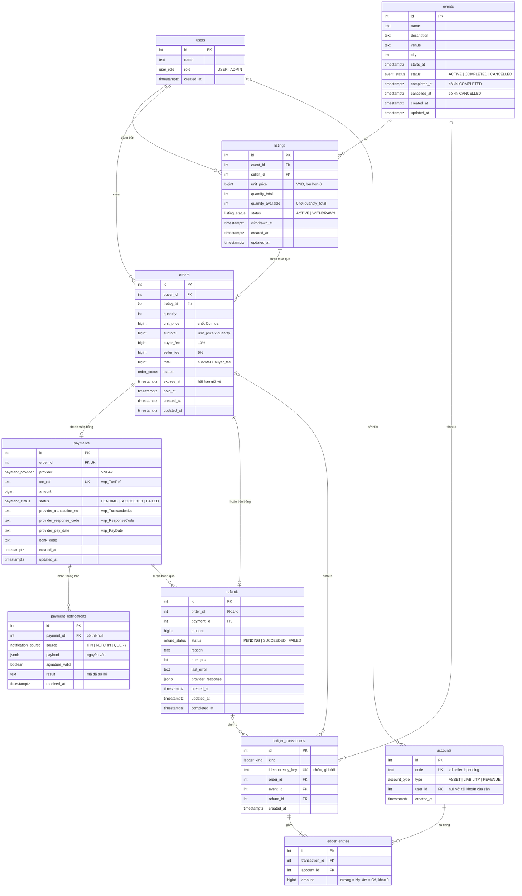
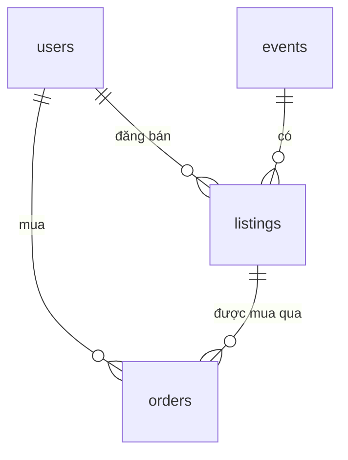
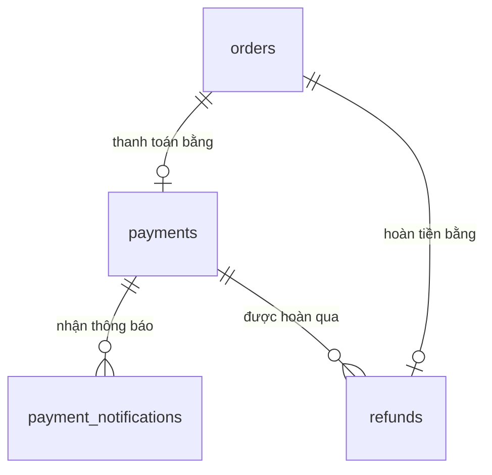
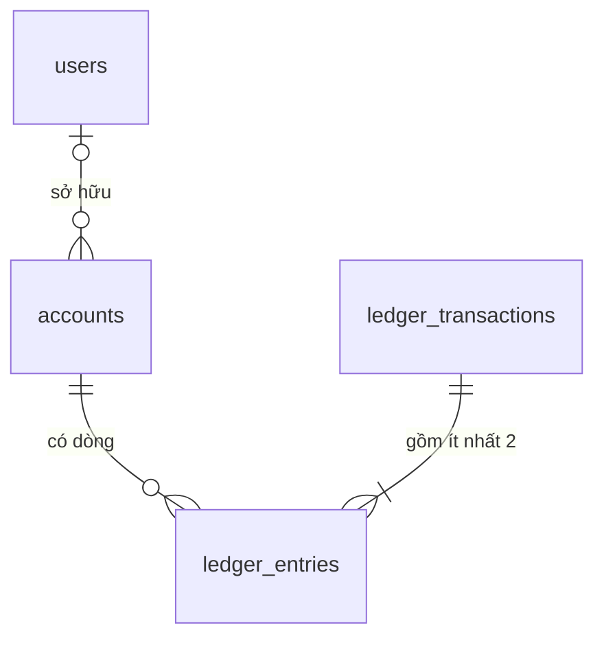
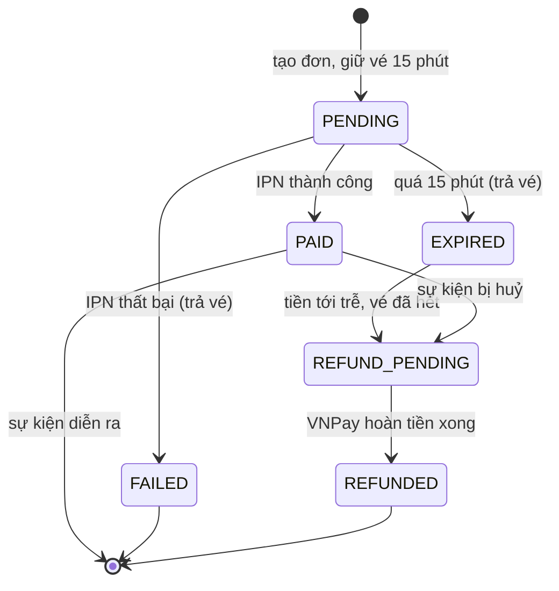
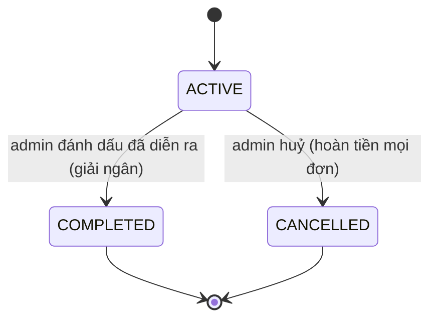
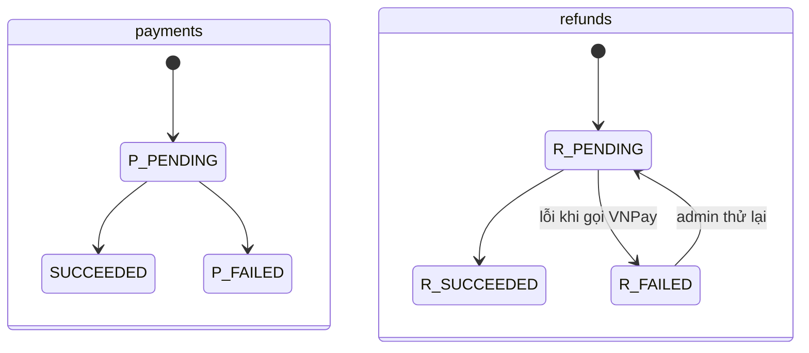
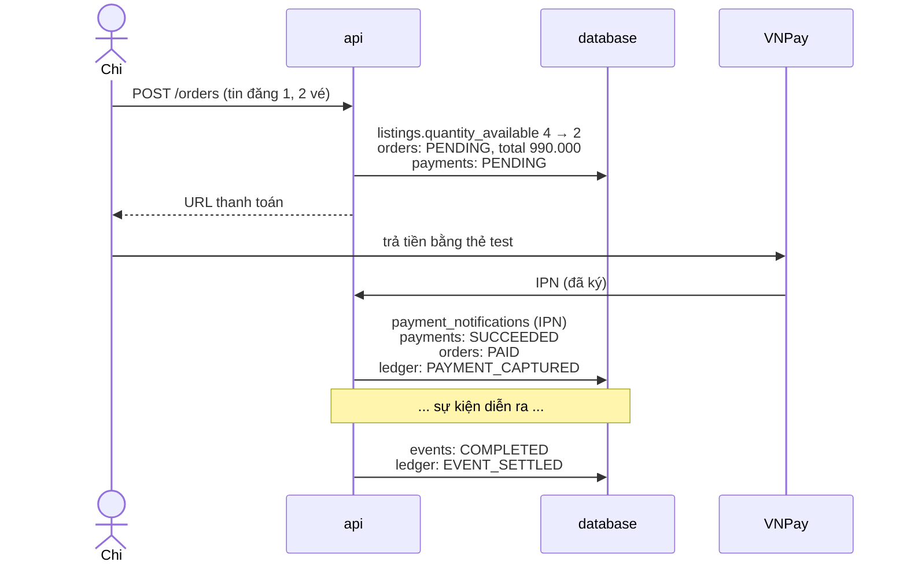

# Hướng dẫn đọc database (từng bảng)

[Tóm tắt kỹ thuật: Cơ sở dữ liệu](07-database.md) · [Khái niệm: index, trigger, khoá dòng, PL/pgSQL…](09-database-concepts.md)

Tài liệu này đi qua từng bảng: bảng dùng để làm gì, từng cột nghĩa là gì, ràng buộc nào bảo vệ
nó, và dữ liệu thật trông ra sao. Cuối tài liệu là một lần mua vé đi qua các bảng theo từng bước,
và vài câu hỏi tự kiểm tra.

Sơ đồ viết bằng [Mermaid](https://mermaid.js.org/). GitHub và VS Code (mở Markdown Preview) tự vẽ
thành hình.

## Mục lục

1. [Cách đọc sơ đồ](#1-cách-đọc-sơ-đồ)
2. [Sơ đồ toàn bộ](#2-sơ-đồ-toàn-bộ)
3. [Nhóm Sàn: users, events, listings, orders](#3-nhóm-sàn)
4. [Nhóm Thanh toán: payments, payment_notifications, refunds](#4-nhóm-thanh-toán)
5. [Nhóm Sổ cái: accounts, ledger_transactions, ledger_entries](#5-nhóm-sổ-cái)
6. [Vòng đời trạng thái](#6-vòng-đời-trạng-thái)
7. [Một lần mua vé đi qua các bảng](#7-một-lần-mua-vé-đi-qua-các-bảng)
8. [Thực hành](#8-thực-hành)
9. [Câu hỏi tự kiểm tra](#9-câu-hỏi-tự-kiểm-tra)

---

## 1. Cách đọc sơ đồ

Mỗi hộp là một bảng; mỗi dòng trong hộp là một cột: `kiểu tên khoá "ghi chú"`.

- `PK` (primary key) – khoá chính, định danh duy nhất của mỗi dòng.
- `FK` (foreign key) – khoá ngoại, trỏ tới khoá chính của bảng khác.
- `UK` (unique key) – giá trị không được trùng giữa các dòng.

Đường nối giữa hai bảng cho biết **mỗi dòng bên này ứng với bao nhiêu dòng bên kia**:

| Ký hiệu     | Đọc là                                |
| ----------- | ------------------------------------- |
| `\|\|--o{`  | một – nhiều (bên nhiều có thể bằng 0) |
| `\|\|--o\|` | một – không hoặc một                  |
| `\|o--o{`   | không hoặc một – nhiều                |

Ví dụ `events ||--o{ listings` đọc là: _một sự kiện có từ 0 tới nhiều tin đăng; mỗi tin đăng
thuộc đúng một sự kiện_.

---

## 2. Sơ đồ toàn bộ



Các bảng chia thành ba nhóm, mỗi nhóm trả lời một câu hỏi:

| Nhóm       | Bảng                                                | Trả lời câu hỏi                         |
| ---------- | --------------------------------------------------- | --------------------------------------- |
| Sàn        | `users`, `events`, `listings`, `orders`             | Ai bán gì, ai mua gì?                   |
| Thanh toán | `payments`, `payment_notifications`, `refunds`      | Cổng thanh toán nói gì về đơn này?      |
| Sổ cái     | `accounts`, `ledger_transactions`, `ledger_entries` | Tiền đang nằm ở đâu, của ai, bao nhiêu? |

---

## 3. Nhóm Sàn



### 3.1. `users` – người dùng

Người dùng demo. Đề bài không yêu cầu đăng nhập, nên không có email hay mật khẩu; người dùng
hiện tại được chọn bằng dropdown.

| Cột          | Kiểu          | Ý nghĩa                                                   |
| ------------ | ------------- | --------------------------------------------------------- |
| `id`         | `int`         | Khoá chính, tự tăng                                       |
| `name`       | `text`        | Tên hiển thị                                              |
| `role`       | `user_role`   | `USER` (mua và bán) hoặc `ADMIN` (vận hành, không mua vé) |
| `created_at` | `timestamptz` | Thời điểm tạo                                             |

Một người vừa có thể bán vừa có thể mua; không có bảng "seller" riêng. Ai là người bán được suy
ra từ `listings.seller_id`.

Dữ liệu mẫu:

| id  | name         | role  |
| --- | ------------ | ----- |
| 1   | Alice Nguyen | USER  |
| 2   | Bob Tran     | USER  |
| 3   | Chi Le       | USER  |
| 4   | Admin        | ADMIN |

### 3.2. `events` – sự kiện

| Cột            | Kiểu           | Ý nghĩa                                   |
| -------------- | -------------- | ----------------------------------------- |
| `id`           | `int`          | Khoá chính                                |
| `name`         | `text`         | Tên sự kiện                               |
| `description`  | `text`         | Mô tả, mặc định chuỗi rỗng                |
| `venue`        | `text`         | Địa điểm                                  |
| `city`         | `text`         | Thành phố                                 |
| `starts_at`    | `timestamptz`  | Thời gian bắt đầu                         |
| `status`       | `event_status` | `ACTIVE` → `COMPLETED` hoặc `CANCELLED`   |
| `completed_at` | `timestamptz`  | Có giá trị **khi và chỉ khi** `COMPLETED` |
| `cancelled_at` | `timestamptz`  | Có giá trị **khi và chỉ khi** `CANCELLED` |
| `created_at`   | `timestamptz`  |                                           |
| `updated_at`   | `timestamptz`  | Prisma tự cập nhật mỗi lần sửa            |

**Ràng buộc:** `CHECK (("status" = 'COMPLETED') = ("completed_at" IS NOT NULL))`. Đọc là: "trạng
thái là COMPLETED" và "completed_at có giá trị" phải cùng đúng hoặc cùng sai. Không thể có sự
kiện `COMPLETED` mà thiếu thời điểm hoàn tất.

**Index:** `(status, starts_at)` – để lấy nhanh "các sự kiện đang mở bán, sắp xếp theo ngày".

**Vì sao quan trọng:** khi `status` chuyển sang `COMPLETED`, tiền escrow của mọi đơn thuộc sự
kiện này được giải ngân cho người bán.

### 3.3. `listings` – tin đăng bán

Một người bán đăng N vé cho một sự kiện với một mức giá.

| Cột                        | Kiểu             | Ý nghĩa                                                                           |
| -------------------------- | ---------------- | --------------------------------------------------------------------------------- |
| `id`                       | `int`            | Khoá chính                                                                        |
| `event_id`                 | `int` FK         | Thuộc sự kiện nào                                                                 |
| `seller_id`                | `int` FK         | Ai bán                                                                            |
| `unit_price`               | `bigint`         | Giá một vé, đơn vị đồng                                                           |
| `quantity_total`           | `int`            | Tổng số vé đăng bán                                                               |
| `quantity_available`       | `int`            | Số vé còn lại; **giảm khi có đơn giữ vé**, tăng lại khi đơn thất bại hoặc hết hạn |
| `status`                   | `listing_status` | `ACTIVE` hoặc `WITHDRAWN` (người bán gỡ phần chưa bán)                            |
| `withdrawn_at`             | `timestamptz`    | Có giá trị khi và chỉ khi `WITHDRAWN`                                             |
| `created_at`, `updated_at` | `timestamptz`    |                                                                                   |

**Ràng buộc:**

- `unit_price > 0`, `quantity_total > 0`
- `quantity_available BETWEEN 0 AND quantity_total` – không bao giờ âm (bán quá số vé) và không
  bao giờ vượt tổng (trả vé hai lần).

**Index:** `(event_id, status)` cho trang sự kiện; `(seller_id)` cho "tin đăng của tôi".

**Vì sao `unit_price` là `bigint` chứ không phải số thực?** VND không có số lẻ. Số thực trong máy
tính bị sai số (`0.1 + 0.2 = 0.30000000000000004`), không chấp nhận được với tiền.

Dữ liệu mẫu:

| id  | event              | seller | unit_price | quantity_available |
| --- | ------------------ | ------ | ---------- | ------------------ |
| 1   | Hà Nội Indie Night | Alice  | 450000     | 4                  |
| 2   | Hà Nội Indie Night | Bob    | 520000     | 3                  |
| 3   | Hà Nội Indie Night | Alice  | 1200000    | 2                  |
| 4   | Saigon Jazz        | Bob    | 800000     | 6                  |
| 5   | Saigon Jazz        | Alice  | 650000     | 2                  |

### 3.4. `orders` – đơn hàng

Một lần mua: người mua X mua N vé từ tin đăng Y.

| Cột                        | Kiểu           | Ý nghĩa                                                 |
| -------------------------- | -------------- | ------------------------------------------------------- |
| `id`                       | `int`          | Khoá chính                                              |
| `buyer_id`                 | `int` FK       | Người mua                                               |
| `listing_id`               | `int` FK       | Mua từ tin đăng nào (từ đó suy ra sự kiện và người bán) |
| `quantity`                 | `int`          | Số vé                                                   |
| `unit_price`               | `bigint`       | Giá một vé **tại thời điểm mua**                        |
| `subtotal`                 | `bigint`       | `unit_price × quantity`                                 |
| `buyer_fee`                | `bigint`       | Phí dịch vụ người mua trả thêm (10%)                    |
| `seller_fee`               | `bigint`       | Phí trừ vào người bán (5%)                              |
| `total`                    | `bigint`       | Số người mua phải trả = `subtotal + buyer_fee`          |
| `status`                   | `order_status` | Xem [vòng đời](#61-đơn-hàng-orders)                     |
| `expires_at`               | `timestamptz`  | Hết hạn giữ vé (tạo đơn + 15 phút)                      |
| `paid_at`                  | `timestamptz`  | Lúc thanh toán thành công                               |
| `created_at`, `updated_at` | `timestamptz`  |                                                         |

**Vì sao chép giá vào đơn mà không đọc từ `listings`?** Nếu người bán đổi giá sau khi bạn đã
mua, đơn của bạn không được phép đổi theo. Đơn hàng là một "biên lai" bất biến.

**Ràng buộc:**

- `quantity > 0`
- `subtotal = unit_price * quantity`
- `total = subtotal + buyer_fee`
- `buyer_fee >= 0`, `seller_fee >= 0`, `seller_fee <= subtotal`

Code tính đúng thì các ràng buộc này không bao giờ bị kích hoạt. Chúng tồn tại để nếu code tính
sai thì database **từ chối lưu** thay vì lưu một đơn sai tiền.

**Index:**

| Index                         | Phục vụ                                          |
| ----------------------------- | ------------------------------------------------ |
| `(buyer_id, created_at DESC)` | "Đơn của tôi", mới nhất trước                    |
| `(listing_id)`                | Tìm đơn của một tin đăng                         |
| `(status, expires_at)`        | Quét đơn `PENDING` đã quá `expires_at` để trả vé |

Ví dụ đơn: mua 2 vé × 500.000đ

| subtotal  | buyer_fee | total     | seller_fee | người bán nhận | sàn giữ |
| --------- | --------- | --------- | ---------- | -------------- | ------- |
| 1.000.000 | 100.000   | 1.100.000 | 50.000     | 950.000        | 150.000 |

---

## 4. Nhóm Thanh toán



**Vì sao tách khỏi `orders`?** Đơn hàng là khái niệm của mình ("Chi mua 2 vé"). Payment là góc
nhìn của cổng thanh toán ("VNPay giao dịch số 14123456, ngân hàng NCB"). Tách ra thì sau này thêm
MoMo chỉ cần thêm `provider = MOMO`, bảng `orders` không đổi.

### 4.1. `payments` – lần thanh toán

| Cột                        | Kiểu               | Ý nghĩa                                          |
| -------------------------- | ------------------ | ------------------------------------------------ |
| `id`                       | `int`              | Khoá chính                                       |
| `order_id`                 | `int` FK, unique   | Mỗi đơn **tối đa một** payment                   |
| `provider`                 | `payment_provider` | Hiện chỉ `VNPAY`                                 |
| `txn_ref`                  | `text` unique      | Mã tham chiếu mình gửi sang VNPay (`vnp_TxnRef`) |
| `amount`                   | `bigint`           | Số tiền (bằng `orders.total`)                    |
| `status`                   | `payment_status`   | `PENDING` → `SUCCEEDED` hoặc `FAILED`            |
| `provider_transaction_no`  | `text`             | Mã giao dịch phía VNPay (`vnp_TransactionNo`)    |
| `provider_response_code`   | `text`             | Mã kết quả VNPay trả về (`00` là thành công)     |
| `provider_pay_date`        | `text`             | Thời điểm VNPay ghi nhận (`yyyyMMddHHmmss`)      |
| `bank_code`                | `text`             | Ngân hàng, ví dụ `NCB`                           |
| `created_at`, `updated_at` | `timestamptz`      |                                                  |

**Vì sao phải lưu `provider_transaction_no` và `provider_pay_date`?** API tra cứu (`querydr`) và
API hoàn tiền của VNPay bắt buộc gửi lại hai giá trị này. Không lưu thì về sau không hoàn tiền
được.

**Ràng buộc:** `amount > 0`.

### 4.2. `payment_notifications` – nhật ký thông báo từ cổng

Mọi tin nhắn từ VNPay (IPN, trình duyệt quay về) và mọi lần mình hỏi VNPay (`querydr`) đều được
**lưu nguyên văn trước khi xử lý**.

| Cột               | Kiểu                  | Ý nghĩa                                                         |
| ----------------- | --------------------- | --------------------------------------------------------------- |
| `id`              | `int`                 | Khoá chính                                                      |
| `payment_id`      | `int` FK, có thể null | Null nếu mã tham chiếu không khớp payment nào (lạ hoặc giả mạo) |
| `source`          | enum                  | `IPN`, `RETURN` hoặc `QUERY`                                    |
| `payload`         | `jsonb`               | Toàn bộ tham số nhận được, nguyên văn                           |
| `signature_valid` | `boolean`             | Chữ ký có hợp lệ không                                          |
| `result`          | `text`                | Mình đã trả lời gì (ví dụ `00`, `97`)                           |
| `received_at`     | `timestamptz`         |                                                                 |

**Vì sao cần bảng này?** Khi có tranh chấp ("tôi đã trả tiền mà đơn báo thất bại"), đây là bằng
chứng VNPay đã nói gì và lúc nào. Nó cũng giúp gỡ lỗi khi IPN không tới.

**Index:** `(payment_id, received_at)` – xem lịch sử thông báo của một lần thanh toán theo thời
gian.

### 4.3. `refunds` – hoàn tiền

| Cột                                        | Kiểu             | Ý nghĩa                                            |
| ------------------------------------------ | ---------------- | -------------------------------------------------- |
| `id`                                       | `int`            | Khoá chính                                         |
| `order_id`                                 | `int` FK, unique | Mỗi đơn tối đa một lần hoàn (hoàn toàn bộ)         |
| `payment_id`                               | `int` FK         | Hoàn cho lần thanh toán nào                        |
| `amount`                                   | `bigint`         | Số tiền hoàn                                       |
| `status`                                   | `refund_status`  | `PENDING` → `SUCCEEDED`, hoặc `FAILED` rồi thử lại |
| `reason`                                   | `text`           | Lý do: sự kiện bị huỷ, thanh toán trễ…             |
| `attempts`                                 | `int`            | Đã gọi VNPay bao nhiêu lần                         |
| `last_error`                               | `text`           | Lỗi gần nhất                                       |
| `provider_response`                        | `jsonb`          | Phản hồi của VNPay                                 |
| `created_at`, `updated_at`, `completed_at` | `timestamptz`    |                                                    |

**Vì sao có `attempts` và `last_error`?** Gọi API bên ngoài có thể thất bại (mạng, VNPay bảo
trì). Hoàn tiền không được "mất" giữa chừng: nó nằm ở `PENDING` hoặc `FAILED` cho tới khi admin
thử lại thành công.

**Index:** `(status)` – liệt kê các lần hoàn đang chờ; `(payment_id)`.

---

## 5. Nhóm Sổ cái



Ý tưởng: giống sổ kế toán giấy. Mỗi lần tiền di chuyển là một **giao dịch**
(`ledger_transactions`), gồm nhiều **dòng** (`ledger_entries`), mỗi dòng cộng hoặc trừ tiền ở một
**tài khoản** (`accounts`). Tổng các dòng của một giao dịch luôn bằng 0: tiền chỉ chuyển chỗ,
không tự sinh ra hay mất đi.

### 5.1. `accounts` – tài khoản

| Cột          | Kiểu           | Ý nghĩa                                   |
| ------------ | -------------- | ----------------------------------------- |
| `id`         | `int`          | Khoá chính                                |
| `code`       | `text` unique  | Tên tài khoản, ví dụ `seller:1:pending`   |
| `type`       | `account_type` | `ASSET`, `LIABILITY` hoặc `REVENUE`       |
| `user_id`    | `int` FK       | Chủ tài khoản; null với tài khoản của sàn |
| `created_at` | `timestamptz`  |                                           |

Ba loại tài khoản, nói theo ngôn ngữ đời thường:

| Loại        | Nghĩa                            | Ví dụ                                                |
| ----------- | -------------------------------- | ---------------------------------------------------- |
| `ASSET`     | Tiền **mình đang có**            | `platform:gateway_clearing` – VNPay đang cầm hộ mình |
| `LIABILITY` | Tiền **mình đang nợ người khác** | `seller:1:pending` – nợ Alice, chờ sự kiện diễn ra   |
| `REVENUE`   | Tiền **mình kiếm được**          | `platform:fee_revenue` – phí sàn đã ghi nhận         |

Danh sách tài khoản:

| code                        | type      | Có khi nào                              |
| --------------------------- | --------- | --------------------------------------- |
| `platform:gateway_clearing` | ASSET     | Seed tạo sẵn                            |
| `platform:fee_pending`      | LIABILITY | Seed tạo sẵn                            |
| `platform:fee_revenue`      | REVENUE   | Seed tạo sẵn                            |
| `seller:{id}:pending`       | LIABILITY | Tạo khi người bán có đơn đầu tiên       |
| `seller:{id}:available`     | LIABILITY | Tạo khi sự kiện đầu tiên được giải ngân |
| `buyer:{id}:refund_payable` | LIABILITY | Tạo khi người mua có khoản cần hoàn     |

### 5.2. `ledger_transactions` – giao dịch

| Cột               | Kiểu          | Ý nghĩa                                                                                    |
| ----------------- | ------------- | ------------------------------------------------------------------------------------------ |
| `id`              | `int`         | Khoá chính                                                                                 |
| `kind`            | enum          | `PAYMENT_CAPTURED`, `EVENT_SETTLED`, `ORDER_CANCELLED`, `LATE_PAYMENT`, `REFUND_COMPLETED` |
| `idempotency_key` | `text` unique | Khoá chống ghi đôi, ví dụ `capture:order:42`                                               |
| `order_id`        | `int` FK      | Giao dịch này liên quan đơn nào (nếu có)                                                   |
| `event_id`        | `int` FK      | … sự kiện nào                                                                              |
| `refund_id`       | `int` FK      | … lần hoàn tiền nào                                                                        |
| `created_at`      | `timestamptz` |                                                                                            |

**`idempotency_key` hoạt động thế nào?** VNPay có thể gửi cùng một IPN 3 lần. Lần đầu ghi giao
dịch với key `capture:order:42`. Lần thứ hai cũng muốn ghi key đó, nhưng cột là `UNIQUE` nên
database từ chối, và code biết là "đã ghi rồi, bỏ qua". Tiền không bị cộng ba lần.

### 5.3. `ledger_entries` – dòng bút toán

| Cột              | Kiểu     | Ý nghĩa                                          |
| ---------------- | -------- | ------------------------------------------------ |
| `id`             | `int`    | Khoá chính                                       |
| `transaction_id` | `int` FK | Thuộc giao dịch nào                              |
| `account_id`     | `int` FK | Tác động lên tài khoản nào                       |
| `amount`         | `bigint` | **Dương = Nợ (debit), âm = Có (credit)**, khác 0 |

**Ba lớp bảo vệ trong database:**

1. `CHECK (amount <> 0)` – một dòng 0 đồng là vô nghĩa, thường là bug.
2. **Trigger cân bằng** – lúc `COMMIT`, mỗi giao dịch phải có ít nhất 2 dòng và tổng bằng 0. Sai
   thì cả transaction bị huỷ.
3. **Trigger chỉ-thêm** – mọi `UPDATE`/`DELETE` trên hai bảng sổ cái đều bị từ chối. Muốn sửa sai
   thì ghi thêm một giao dịch đảo ngược, giống kế toán thật.

### 5.4. View `account_balances` – số dư

Không phải bảng mà là một **view**: một câu truy vấn được đặt tên, chạy lại mỗi lần đọc.

```sql
SELECT * FROM account_balances;
```

Nó cộng mọi dòng của từng tài khoản. Tài sản thì giữ nguyên dấu; nợ phải trả và doanh thu thì đảo
dấu để số dư hiển thị là số dương cho dễ đọc.

**Vì sao không lưu số dư vào một cột?** Nếu vừa có sổ cái vừa có cột số dư, sớm muộn hai thứ sẽ
lệch nhau, và không ai biết cái nào đúng. Tính từ sổ cái thì chỉ có một sự thật. Đề bài cũng yêu
cầu đúng điều này: _"Every balance must be derivable from the ledger."_

---

## 6. Vòng đời trạng thái

### 6.1. Đơn hàng (`orders`)



### 6.2. Sự kiện (`events`)



### 6.3. Thanh toán (`payments`) và hoàn tiền (`refunds`)



(Tiền tố `P_` và `R_` chỉ để phân biệt trong hình; trong database tên trạng thái là `PENDING`,
`SUCCEEDED`, `FAILED`.)

---

## 7. Một lần mua vé đi qua các bảng

Chi (user 3) mua 2 vé từ tin đăng 1 của Alice (450.000đ/vé), sau đó sự kiện diễn ra.



Số tiền: tạm tính 900.000; người mua trả 990.000 (thêm 10%); người bán nhận 855.000 (trừ 5%); sàn
giữ 135.000.

### Bước 1 – Tạo đơn

| Bảng       | Thay đổi                                                                                                                                                      |
| ---------- | ------------------------------------------------------------------------------------------------------------------------------------------------------------- |
| `listings` | dòng 1: `quantity_available` 4 → **2**                                                                                                                        |
| `orders`   | dòng mới: buyer 3, listing 1, quantity 2, subtotal 900.000, buyer_fee 90.000, seller_fee 45.000, total **990.000**, `PENDING`, expires_at = bây giờ + 15 phút |
| `payments` | dòng mới: `txn_ref` mới, amount 990.000, `PENDING`                                                                                                            |

Chưa có dòng nào trong sổ cái: **chưa có tiền nào di chuyển**.

### Bước 2 – VNPay gửi IPN thành công

| Bảng                    | Thay đổi                                                                      |
| ----------------------- | ----------------------------------------------------------------------------- |
| `payment_notifications` | dòng mới: source `IPN`, payload nguyên văn, signature_valid true, result `00` |
| `payments`              | `SUCCEEDED`, lưu `provider_transaction_no`, `bank_code`…                      |
| `orders`                | `PAID`, `paid_at` = bây giờ                                                   |
| `accounts`              | tạo `seller:1:pending` nếu chưa có                                            |
| `ledger_transactions`   | `PAYMENT_CAPTURED`, key `capture:order:<id>`                                  |
| `ledger_entries`        | 3 dòng bên dưới                                                               |

| account                     | amount       | Đọc là                                   |
| --------------------------- | ------------ | ---------------------------------------- |
| `platform:gateway_clearing` | **+990.000** | VNPay đang cầm hộ mình 990.000           |
| `seller:1:pending`          | **−855.000** | Mình nợ Alice 855.000, chờ sự kiện       |
| `platform:fee_pending`      | **−135.000** | Phí 135.000, chưa được tính là doanh thu |
| **Tổng**                    | **0**        |                                          |

Tất cả nằm trong **một transaction**: hoặc mọi thay đổi trên cùng thành công, hoặc không có thay
đổi nào.

### Bước 3 – Sự kiện diễn ra, admin bấm "Đánh dấu đã diễn ra"

| Bảng                  | Thay đổi                                 |
| --------------------- | ---------------------------------------- |
| `events`              | `COMPLETED`, `completed_at` = bây giờ    |
| `accounts`            | tạo `seller:1:available` nếu chưa có     |
| `ledger_transactions` | `EVENT_SETTLED`, key `settle:order:<id>` |
| `ledger_entries`      | 4 dòng bên dưới                          |

| account                | amount       | Đọc là                         |
| ---------------------- | ------------ | ------------------------------ |
| `seller:1:pending`     | **+855.000** | Hết nợ Alice ở mục "đang giữ"… |
| `seller:1:available`   | **−855.000** | …chuyển sang mục "khả dụng"    |
| `platform:fee_pending` | **+135.000** | Phí hết ở trạng thái chờ…      |
| `platform:fee_revenue` | **−135.000** | …thành doanh thu thật          |
| **Tổng**               | **0**        |                                |

### Kết quả trong `account_balances`

| code                        | balance |
| --------------------------- | ------- |
| `platform:gateway_clearing` | 990.000 |
| `seller:1:pending`          | 0       |
| `seller:1:available`        | 855.000 |
| `platform:fee_pending`      | 0       |
| `platform:fee_revenue`      | 135.000 |

Kiểm tra: tài sản 990.000 = nợ Alice 855.000 + doanh thu 135.000. Sổ cân.

---

## 8. Thực hành

### Xem dữ liệu bằng giao diện

```bash
npm run db:studio -w @tc/api
```

Prisma Studio mở trên trình duyệt; bấm vào từng bảng để xem dữ liệu.

### Chạy SQL trực tiếp

```bash
docker compose exec db psql -U tc -d tc
```

Vài câu để thử (gõ `\q` để thoát):

```sql
-- Danh sách bảng
\dt

-- Cấu trúc một bảng, kèm ràng buộc và index
\d orders

-- Tin đăng kèm tên sự kiện và người bán
SELECT l.id, e.name AS event, u.name AS seller, l.unit_price, l.quantity_available
FROM listings l
JOIN events e ON e.id = l.event_id
JOIN users u ON u.id = l.seller_id;

-- Số dư mọi tài khoản
SELECT * FROM account_balances;

-- Tổng toàn bộ sổ cái (luôn phải bằng 0)
SELECT COALESCE(SUM(amount), 0) FROM ledger_entries;
```

### Thử phá ràng buộc (an toàn: database sẽ từ chối)

```sql
-- Số vé còn lại vượt tổng → lỗi listings_quantity_available_range
UPDATE listings SET quantity_available = 99 WHERE id = 1;

-- Sự kiện COMPLETED mà không có completed_at → lỗi events_completed_at_matches_status
UPDATE events SET status = 'COMPLETED' WHERE id = 1;
```

---

## 9. Câu hỏi tự kiểm tra

<details>
<summary>1. Vì sao <code>orders</code> chép lại <code>unit_price</code> thay vì đọc từ <code>listings</code>?</summary>

Người bán có thể đổi giá sau khi đơn đã đặt. Đơn là biên lai, phải giữ đúng số tiền tại thời điểm
mua.

</details>

<details>
<summary>2. VNPay gửi cùng một IPN hai lần. Điều gì ngăn tiền bị ghi hai lần?</summary>

Cột `ledger_transactions.idempotency_key` là `UNIQUE`. Lần thứ hai dùng cùng key nên bị từ chối;
code nhận ra và trả lời VNPay mã `02` (đã xử lý).

</details>

<details>
<summary>3. Số dư "đang giữ" của Alice lấy từ đâu?</summary>

Từ tổng các dòng `ledger_entries` của tài khoản `seller:1:pending` (đảo dấu vì là tài khoản nợ
phải trả). Không có cột số dư nào được lưu.

</details>

<details>
<summary>4. Một bug trong code ghi bút toán +990.000 / −855.000 và quên dòng −135.000. Chuyện gì xảy ra?</summary>

Tổng các dòng là +135.000, khác 0. Lúc `COMMIT`, trigger `ledger_assert_balanced` báo lỗi và cả
transaction bị huỷ, kể cả việc chuyển đơn sang `PAID`. Không có dữ liệu sai nào được lưu.

</details>

<details>
<summary>5. Vì sao phí của sàn nằm ở <code>fee_pending</code> trước rồi mới sang <code>fee_revenue</code>?</summary>

Nếu sự kiện bị huỷ, người mua được hoàn toàn bộ, kể cả phí. Trước khi sự kiện diễn ra, khoản phí
chưa chắc chắn là của sàn, nên chưa được tính là doanh thu.

</details>

<details>
<summary>6. Vì sao <code>payment_notifications.payment_id</code> được phép null?</summary>

Có thể nhận được thông báo với mã tham chiếu không khớp payment nào (giả mạo hoặc lỗi). Vẫn phải
lưu lại làm bằng chứng, nhưng không có payment nào để gắn vào.

</details>

<details>
<summary>7. Index <code>(status, expires_at)</code> trên <code>orders</code> để làm gì?</summary>

Phục vụ việc quét định kỳ `WHERE status = 'PENDING' AND expires_at < now()` để tìm đơn hết hạn và
trả vé. Không có index, database phải đọc toàn bộ bảng đơn mỗi lần quét.

</details>
